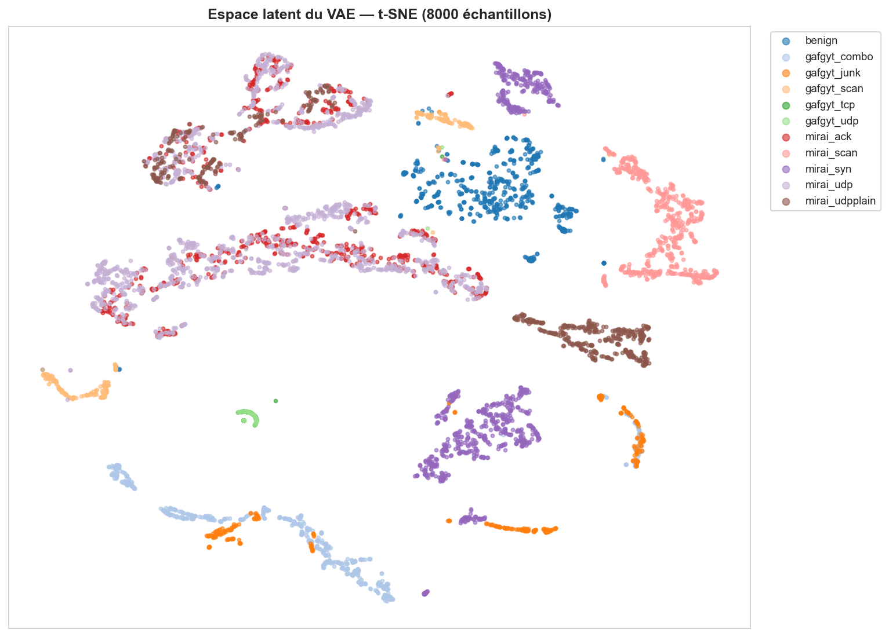
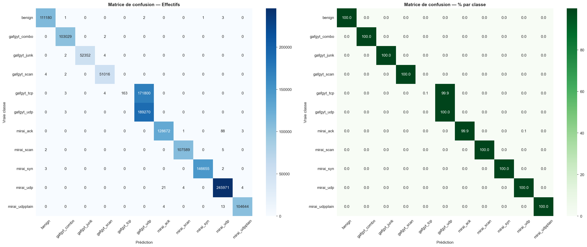

<div align="center">

# 🛡️ IoT Botnet Detection — VAE + XGBoost

**Hybrid Deep Learning + Machine Learning approach for detecting IoT botnet attacks on real network traffic.**

[](https://www.python.org/)
[](https://www.tensorflow.org/)
[](https://xgboost.readthedocs.io/)
[](LICENSE)

</div>

---

## 📖 Overview

This project detects botnet attacks (**Mirai** & **Gafgyt**) on IoT devices using a **two-stage hybrid pipeline**:

1. **Variational AutoEncoder (VAE)** — learns a compact 20-dimensional latent representation of network traffic in an unsupervised way (trained on benign traffic only).
2. **XGBoost** — classifies the latent features into 11 attack categories (and binary normal/attack).

The model is evaluated on **N-BaIoT**, a dataset of **7+ million real network flows** captured from **9 commercial IoT devices**.

---

## 🎯 Results

### Binary Classification (Normal vs Attack)

| Metric    | Score      |
|-----------|------------|
| Accuracy  | **99.99%** |
| Precision | 99.99%     |
| Recall    | 99.99%     |
| F1-Score  | 99.99%     |

### Multi-Class Classification (11 classes)

| Metric    | Score      |
|-----------|------------|
| Accuracy  | **87.83%** |
| Precision | 93.62%     |
| Recall    | 87.83%     |
| F1-Score  | 83.66%     |

> **Note:** The multi-class score is bounded by a structural limitation of the dataset — `gafgyt_tcp` and `gafgyt_udp` produce nearly identical statistical signatures (the Kitsune features are protocol-agnostic), making them inherently hard to separate.

---

## 🏗️ Architecture

```
Network flow (115 features)
        |
        v
+---------------------+
|   VAE Encoder       |   115 -> 96 -> 64 -> 32
|                     |
|   mu(20)+logvar(20) |   probabilistic bottleneck
|   z = mu + sigma*e  |   reparameterization trick
+---------------------+
        |
        v  latent features (mu, 20D)
+---------------------+
|   XGBoost           |   400 trees, sequential boosting
+---------------------+
        |
        v
   Prediction (11 classes)
```

**VAE loss** combines reconstruction and regularization:

```
L = MSE(x, x_hat) + beta * KL( N(mu,sigma^2) || N(0,I) )
```

The KL term forces a continuous Gaussian latent space, improving class separation.

---

## 📊 Visualizations

<div align="center">

| Latent Space (t-SNE) | Confusion Matrix |
|:---:|:---:|
|  |  |

</div>

The circular structure of the latent space is the signature of the KL regularization (Gaussian prior).

---

## 📁 Dataset

**N-BaIoT** — [UCI Machine Learning Repository](https://archive.ics.uci.edu/dataset/442/detection+of+iot+botnet+attacks+n+baiot)

| Property        | Value                              |
|-----------------|------------------------------------|
| Flows           | 7,062,606                          |
| Features        | 115 (extracted via Kitsune)        |
| Devices         | 9 commercial IoT devices           |
| Classes         | 11 (1 benign + 5 Gafgyt + 5 Mirai) |

The 115 features are statistical aggregations over sliding time windows (5s, 3s, 1s, 100ms, 10ms) of packet volume, magnitude, and correlation.

---

## 🚀 Quick Start

### 1. Clone the repo

```bash
git clone https://github.com/YOUR_USERNAME/iot-botnet-detection.git
cd iot-botnet-detection
```

### 2. Install dependencies

```bash
pip install -r requirements.txt
```

### 3. Download the dataset

Download N-BaIoT from [UCI](https://archive.ics.uci.edu/dataset/442/detection+of+iot+botnet+attacks+n+baiot) and update `BASE_PATH` in the notebook.

### 4. Run the notebook

```bash
jupyter notebook notebooks/VAE_XGBoost.ipynb
```

---

## 🔬 Pipeline Details

### Robust Preprocessing (key step)

Raw Kitsune features reach values up to `1e12` (DDoS bursts), which cause neural network divergence. A 4-step normalization pipeline solves this:

| Step | Operation         | Effect                       |
|------|-------------------|------------------------------|
| 1    | Clip P1-P99       | Removes extreme outliers     |
| 2    | Signed log        | Compresses `1e12` to `~28`   |
| 3    | StandardScaler    | Centers to mean 0, std 1     |
| 4    | Clip +/-5 sigma   | Guarantees `[-5, +5]` range  |

All statistics are computed **on the training set only** (no data leakage).

### Why train the VAE on benign traffic only?

The VAE learns the distribution of *normal* traffic. Anomalies (attacks) are poorly reconstructed -> high reconstruction error -> detectable. This is a classic **one-class anomaly detection** strategy that also generalizes to zero-day attacks.

### Why use mu instead of z for XGBoost?

`z = mu + sigma*epsilon` is stochastic (changes every forward pass). `mu` is deterministic -> stable, reproducible features for the classifier.

---

## 🗂️ Project Structure

```
iot-botnet-detection/
├── notebooks/
│   └── VAE_XGBoost.ipynb        # Full pipeline
├── images/                       # Generated plots
├── models/                       # Saved models (after training)
├── requirements.txt
├── LICENSE
└── README.md
```

---

## 🛠️ Tech Stack

- **TensorFlow / Keras** — VAE implementation
- **XGBoost** — gradient boosting classifier
- **scikit-learn** — preprocessing, metrics, t-SNE
- **NumPy / Pandas** — data handling
- **Matplotlib / Seaborn** — visualizations

---

## 📜 License

This project is licensed under the MIT License — see [LICENSE](LICENSE) for details.

---

<div align="center">

⭐ If you find this project useful, consider giving it a star!

</div>
